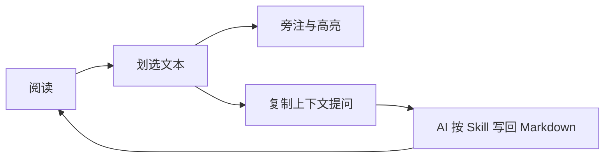

# 用 LiMR 阅读与思考

这份文档同时是使用示例。点击编辑器右上角的 **Open Reader to the Side**，可以让 Markdown 源码与阅读器并排显示。

## 从一段文字开始

划选文字，添加高亮、旁注或提问。::%%limr%%{<#welcome-shared}同一段内容可以关联多条标注，修改一条旁注不会删除其他提问或共享高亮。::%%limr%%{>#welcome-shared}

默认只读。在 **VS Code 原生编辑器工具栏**启用编辑，或执行 **LiMR: Toggle Markdown Editing** 后，标注与任务状态直接写入此 Markdown 文档，可以使用 VS Code 的撤销、保存和 Git。阅读状态显示在原生状态栏。

- [ ] 给这段文字添加一个旁注
- [ ] 从原生工具栏试用 Playground Light / Dark、One Dark Pro / Darker
- [ ] 复制「提问上下文」，粘贴给 AI 助手

## 语言与代码

默认使用 **Playground（跟随 VS Code 明暗）** 的阅读配色和字体。中文正文、English prose、其他文字 Ελληνικά / 日本語，以及代码可以使用不同字体与字号，通过 **LiMR: Reader Settings** 调整。

正文默认使用 **Noto Serif SC Variable**，代码默认使用 **Maple Mono NF CN**，字体随扩展提供。

```typescript
type Thought = { question: string; answer?: string };

function keepThinking(thought: Thought): boolean {
  return thought.answer === undefined;
}
```

数学公式也可以阅读：$E = mc^2$。



## 阅读偏好

使用排版和翻译按钮选择当前文件设置或默认配置。目录可选择“仅宽度允许”，窄屏就不会在正文上方显示目录。顶栏和底栏按钮可以分别设置。

## AI 协作

从 **VS Code 原生编辑器工具栏的 AI 子菜单**安装技能，或查看 [AI 标注指引](../docs/ai-guide.md)。复制上下文后，在 Codex 等助手中粘贴并输入问题。已知的会话信息可以由 AI 写入 annotation；没有可靠信息时不编造 ID。

:::limr-annotation{#welcome-highlight ranges="welcome-shared" type="highlight" style="background" color="#E5C07B" hidden="false"}
:::

:::limr-annotation{#welcome-note ranges="welcome-shared" type="margin-note"}
旁注和提问有各自稳定的 ID。点击悬浮卡片或侧栏中的 **编辑**，试着改写这条旁注。
:::

:::limr-annotation{#welcome-question ranges="welcome-shared" type="question"}
为什么将标注直接保存在 Markdown 中，更适合 Git 和 AI 协作？
:::
